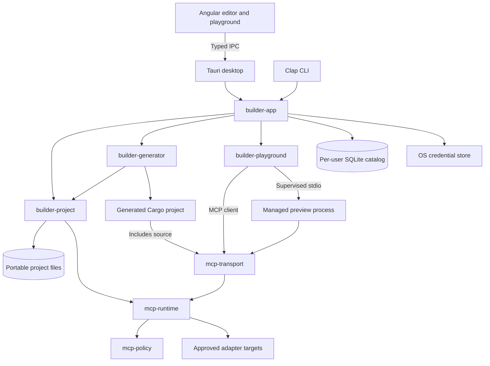
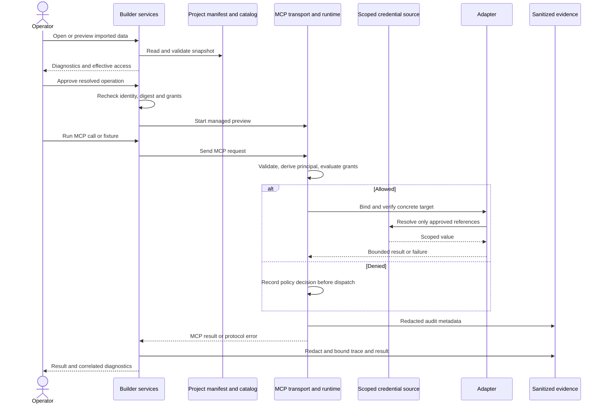
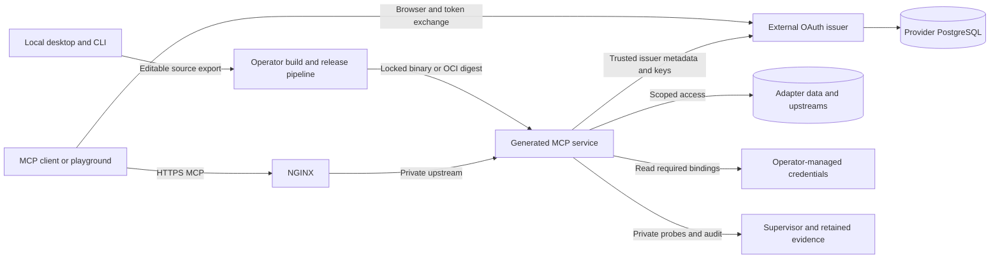
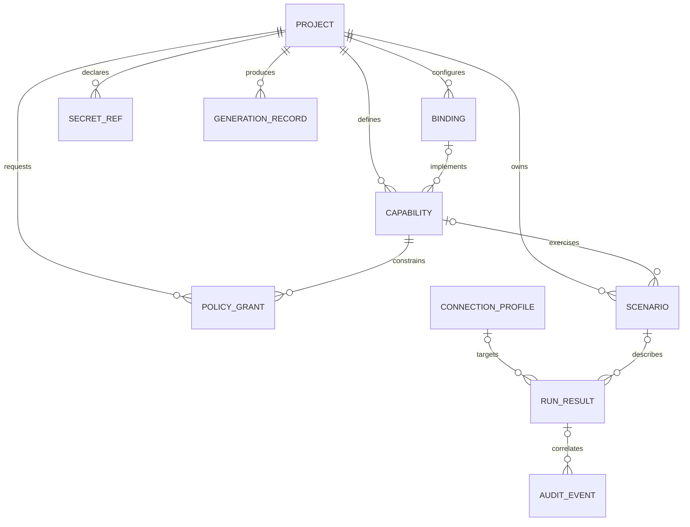

# MCP Server Builder architecture

Phase 0 design · [Product requirements](requirements.md) · [Shared contracts](contracts.md) · [Decision records](../DECISIONS.md) · [Task backlog](../TASKS.md)

The builder is a local desktop application and CLI. Both use the same Rust application services. An export is a standalone Rust project with the same capability dispatch, policy and transport implementations. One generated process serves one operator-owned project and may serve several authenticated principals. The Windows MVP ships stdio. Commercial v1 adds the authenticated Streamable HTTP service on Linux. [Release scope](../PLAN.md#release-scope)

## Components and workspace boundaries

The paths below are the initial Cargo and Angular source layout. Application-service DTOs stay independent of Tauri, Clap, SQLx rows, and MCP wire types. Dependencies flow from shells into services and from bindings into shared runtime logic. F1 owns the workspace and the initial boundary checks. Later tasks own the components listed here.

| Planned location | Owns | Task owner |
| --- | --- | --- |
| `crates/mcp-policy` | Serializable grants and constraints, typed principal and operation context, deny-by-default decision and reason codes, execution limits and reusable redaction primitives. Receives resolved facts from platform and transport callers. | Runtime and security · M2, V2 |
| `crates/mcp-runtime` | Transport-neutral server definition, schemas, registry, dispatch, per-request deadline and cancellation, scoped credential resolver and audit sink interfaces, adapter implementations and shared native process supervision primitives. Performs target checks where access occurs. | Runtime and integrations · M3, M5, V5–V8 |
| `crates/mcp-transport` | Server and client feature sets for stdio and Streamable HTTP, revision selection, lifecycle, wire DTOs and error mapping, Axum ingress checks and resource-server authentication. Isolates `rmcp` and translates wire data into runtime types. | MCP and security · M3, M4, V3, V4 |
| `crates/builder-project` | Portable document, semantic validation, migration registry, safe import parsing and projection to the shared server definition. Exposes manifest revisions and diagnostics to application services. | Project core · M1, V1 |
| `crates/builder-generator` | Bundled templates, locks and runtime versions, export planning, deterministic rendering, staging and regeneration conflict detection. Invokes the project validator and packages the selected runtime sources. | Generator · M6, V7, V9 |
| `crates/builder-playground` | Approved process startup, connected client handles, scenario evaluation, fixture control, run cancellation and trace collection. Uses the shared transport client and process supervision primitives. | Playground · M7, V4 |
| `crates/builder-app` | Shared project, generation, connection and run use cases. Owns SQLx catalog, local credential provider, approval lifecycle, evidence store, and builder-only entitlement boundary. Composes the other crates. | Rust application services · M1, M7, V1, V2, V13 |
| `apps/cli` | Clap commands and I/O, shared service invocation, packaged managed-preview entry point, and versioned JSON and exit-code mapping. | CLI · F1, M9, V12 |
| `apps/desktop/src-tauri`, `apps/desktop/ui/src` | Main-window Tauri capabilities and DTO bridge, native dialogs, and Angular strict TypeScript and Signals workflows. IPC data and external output render as text. | Desktop · F1, M8, V11 |
| Generated export root | A separate Cargo workspace with a server crate, path dependencies on bundled `mcp-policy`, `mcp-runtime` and server-side `mcp-transport`, locked dependency graph, project-owned entry points and tests. | Generator and platform · M6, V9, R1, R2 |

Use Tokio for async runtime and supervision, Serde for typed serialization, tracing for structured diagnostics, and Axum for Streamable HTTP. The native application owns filesystem access and credential lookups. The preview is a supervised invocation of the installed, version-matched first-party runner. It receives a prepared definition and narrow credential bindings after approval. A third-party stdio profile or custom Rust build is a separate, explicitly trusted operation under the user's OS identity. [Trust boundaries](security.md#trust-boundaries-and-threats) · [Toolchain decision](../DECISIONS.md#adr-008--toolchain-platforms-and-packaging)

## Project and request data flow

Validation and export can work with an inert project snapshot. Generation stages and publishes source. Build and launch are independently reviewed. Preview and exports evaluate the same grants and enforce them at dispatch and at the adapter. Preview loads an approved local policy snapshot. Deployment loads the operator's bindings and active policy. The effective decision is the intersection of declared permissions, the active operator grant, the principal's permissions and the request limits. [Policy enforcement](security.md#policy-enforcement) · [Approvals and credential contract](contracts.md#policy-approvals-and-credentials)

## Deployment relationships

The reference deployment is one service process behind NGINX, with a private backend under systemd or on a private Compose network. The resource server serves protected resource metadata and validates bearer tokens. The separate provider owns sign-in, consent, token issuance, keys and its identity database. Generated integration data and audit state have independent ownership and backup. The managed preview is local stdio. An unauthenticated HTTP fixture binds only to loopback and exists for conformance. [Deployment profiles and operations](deployment.md#generated-linux-service) · [OAuth and client profiles](../DECISIONS.md#adr-007--external-oauth-and-client-profiles)

## Logical data model

A template prompt has no adapter binding. A direct playground call can have no saved scenario, and deployed requests can produce audit events independently of any builder run. Audit correlation uses an ID within the producing service's evidence. Reports for unrelated external servers carry the local correlation and any vetted remote correlation available.

| Entity | Identity and relationship | Source of truth and lifetime |
| --- | --- | --- |
| Project | UUID and manifest revision. Owns server identity, transport selection, environment and dependency declarations, capabilities, bindings, requested policy and scenarios. | `mcp-project.json` and explicitly referenced project assets. A copied working directory may contain the same project UUID. Local profiles and credentials also key on the local project registration. |
| Capability and integration binding | Stable keys within a project. A capability maps a tool name, resource URI or URI template, or prompt name to a validated handler. Bindings describe integration operations and scoped target references. | Portable project. The runtime builds an immutable registry from a validated snapshot at launch. |
| Policy grant and local approval | Grants identify the capability and permitted operation, target and limits. An approval binds one operator and operation to the reviewed plan and content identity. | Requested grants in the portable project. Accepted local approvals in memory or the local catalog. Deployment grants and principal mappings in operator-owned configuration. |
| Secret reference and local secret binding | Named reference scoped to a project/binding or connection. OAuth credentials additionally key on issuer, canonical resource, client and account. | The project carries names and purpose. Local mapping metadata lives in the catalog. Values live in a platform credential store, session memory, or an explicit environment or deployment binding. |
| Connection profile | Local UUID and revision. Contains inert stdio or HTTP connection inputs, protocol choice and trust-review state. May point to a builder project or an external server. | Local catalog. Client configuration import creates this entity. |
| Scenario and run result | A scenario specifies an invocation, fixture or live mode, and assertions. A run has an ID, correlation ID, timing, target, revision and result. | Scenario definitions are portable. Run results are local evidence. Trace payloads are transient unless the operator exports a sanitized report. |
| Audit event | Event UUID, timestamp, principal, operation, policy decision, outcome and correlation. | Local catalog for builder events. Generated services write to their own bounded audit sink. |
| Generation record | Manifest digest and schema, generator, runtime, template and supported protocol versions, lock digest, and file ownership and digests. | Portable with the generated tree. Builder history can reference the record without becoming a build dependency. |

The catalog can be rebuilt as an index of known project folders. Local profiles, approvals, and evidence need their own backup. Restoring those records preserves their original scopes and triggers normal approval and credential revalidation. A portable import or duplicate creates a new local registration and requires its own approvals. [Persistence, migration and evidence contracts](contracts.md#local-persistence-and-migration)
