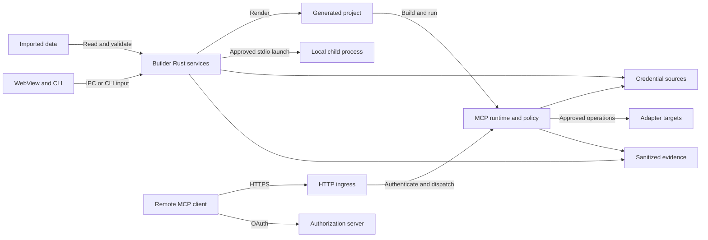

# MCP Server Builder security design

Phase 0 · D3 · 12 November 2026

An imported project can describe code, commands, and access to private data. Opening it must leave those requests inert. The managed runtime must enforce the operator's grant for each caller and capability. The main risks are execution under the desktop user's account, unauthorized access through a deployed server, and credentials or customer data escaping through evidence. This is a proposed design for the Windows local MVP and commercial v1. The baseline contains planning artifacts, and the verification cases below are implementation acceptance checks. [Architecture](../PLAN.md#architecture-to-validate) · [Security acceptance criteria](../PLAN.md#security-acceptance-criteria)

## System model

The Angular WebView and Clap CLI call shared Rust services for project storage, import, generation, and the playground. The project manifest travels with exported source. Local approvals, run history, and audit metadata stay in the builder's local storage. Generated servers bundle the versioned Rust runtime and enforce policy at dispatch and at the adapter boundary, including when built and run independently. Commercial v1 adds remote Streamable HTTP through an HTTPS endpoint and an external OAuth authorization server. [Planned architecture](../PLAN.md#architecture-to-validate) · [Task ownership](../TASKS.md)

The design assumes a regular local OS account and one operator-owned project per deployed server, which may serve multiple authenticated principals. Treat imported content, child process output, network responses, and MCP calls as attacker-controlled. A remote caller may be anonymous or hold a valid low-privilege token. A third-party project author may supply source or misrepresent its requested permissions. Trust the host OS, the operator's administration of the service and its storage, and the configured authorization server. A compromised administrator or approved arbitrary code can act with the service or launch account's privileges. Hosted multi-tenant builder infrastructure falls outside the v1 release scope. [Release scope](../PLAN.md#release-scope)

The local MVP needs one-run launch approval, shared policy, REST and read-only filesystem grants, explicit secret bindings, and sanitized traces. Commercial v1 adds reusable approvals, native credential storage, audit retention, additional adapters, and authenticated remote connections. [Implementation order](../PLAN.md#implementation-order-and-exit-criteria) · [MVP and commercial v1 assignments](../TASKS.md#local-mvp)

### Assets and security objectives

| Asset | Security objective |
| --- | --- |
| OS account, local files and child processes | Preserve host integrity and availability. Limit which executable runs, what it receives, and how long supervised work lasts. |
| Manifest, local approvals, templates, runtime and generated source | Preserve integrity and provenance across import, regeneration, approval, and deployment. |
| OAuth tokens, adapter credentials and signing trust | Preserve confidentiality and bind each credential to its intended account, issuer, resource or adapter. |
| Files, databases, Git repositories and upstream APIs | Preserve confidentiality and integrity across callers and restrict reads and mutations to authorized targets. |
| MCP requests, results, fixtures, traces and audit | Prevent sensitive content from leaking through capture or export. Preserve enough audit metadata to attribute decisions and diagnose failures. |
| HTTP endpoint, workers and storage | Bound request, process and evidence costs so one caller or project cannot monopolize service capacity. |

### Trust boundaries and threats

Priorities reflect exposure and impact before implementation. Critical means an internet-facing authentication failure could grant unauthorized access to protected data or effects. High means a routine workflow or an authenticated caller could expose credentials, alter protected data, or execute code. Medium covers bounded service disruption or abuse requiring control of an approved component.

| Boundary and data crossing | Threat and impact | Initial priority | Verification |
| --- | --- | --- | --- |
| Files or client config → import and preview, via JSON and archives | A commonly shared project carries unsafe archive entries or requests execution, exposing local files or modifying a workspace during open. | High | [TM-001](#tm-001-import-and-preview) |
| WebView or CLI → Rust services, via typed IPC or CLI inputs | Content supplied by a project or remote tool reaches a privileged native action and triggers a build, launch, or credential lookup without operator approval. | High | [TM-002](#tm-002-privileged-entry-points) |
| Manifest and templates → generator → output tree and build, via files | A parameter escapes its template context or redirects a write. An unreviewed build can run dependency code under the host account. | High | [TM-003](#tm-003-generation-and-build) |
| Supervisor → local process, via executable, arguments, environment and pipes | A changed launch target inherits prior approval. A child can also flood output or leave processes running after shutdown. | High for launch substitution. Medium for disruption by approved code. | [TM-004](#tm-004-local-launch) |
| Credential source or runtime payload → adapter, UI and evidence sinks | A credential reaches a different binding, or a token or private payload enters diagnostics, fixtures, audit or reports. These flows occur on ordinary success and failure paths. | High | [TM-005](#tm-005-credentials-and-evidence) |
| Runtime → OS filesystem, database, Git, HTTP or executable | A low-privilege caller supplies values that steer an otherwise allowed capability outside its grant. The runtime's ambient privileges can widen the effect. | High | [TM-006](#tm-006-adapter-boundaries) |
| Remote client → ingress → MCP runtime, via HTTP headers, access token and body | An unauthenticated caller reaches a protected method, a token for a different resource is accepted, or a scoped client consumes capacity or crosses a capability boundary. | Critical for authentication bypass. High for cross-capability access. Medium for bounded resource exhaustion. | [TM-007](#tm-007-http-ingress-and-resource-server) |
| Playground → MCP endpoint, discovery URLs, browser callback and token endpoint | A hostile endpoint influences discovery or the callback, sending a request to a private service or causing credentials to be associated with the wrong issuer or resource. | High | [TM-008](#tm-008-playground-oauth-and-provider) |

## Policy enforcement

- Use one Rust evaluator for the GUI, CLI, managed preview and generated runtime. Accept only typed native IPC from the local app window and expose specific project and run operations. Render project data and tool output as text. Apply a restrictive WebView content security policy and keep privileged IPC unavailable to remote content. Treat CLI arguments and IPC calls as requests to the same service-side checks. [Tauri capabilities](https://v2.tauri.app/security/capabilities/)
- Default to stdio without a listening socket and deny adapter access until an operator grants a specific binding. At dispatch, validate the protocol envelope and capability schema, derive the principal from the local launch context or verified token, and evaluate operation, capability, concrete target, and limits. Effective access is the intersection of the configured grant and local approval or remote principal permissions, including required OAuth scopes. Evaluate reads, invocations and protected discovery. Use principal-scoped caching for caller-specific results. MCP headers, resource identifiers and tool annotations are input to validate.
- Check policy before credential resolution or adapter effects. Bind the checked target to the file handle, approved peer, statement or executable actually used. Bind local launch approval to a policy snapshot and invalidate reusable approval when it changes. Use the active policy for every remote request. Recheck target constraints at use and enforce deadlines, cancellation, concurrency and bounded output. Fail closed when a required check or credential lookup fails. Keep preview and export defaults identical. Use local fixtures for replay unless the operator explicitly selects live execution, which uses the same policy.
- Imported permissions are requests. Store approvals outside portable manifests and exports, tied to the local operator, operation and reviewed configuration. Require an explicit approval for a first build or launch and for changes that affect its identity or privileges. A headless workflow supplies explicit operator-owned approval through the CLI. Keep validation, generation, build and launch as separate actions.

## Local workflows and credentials

**Import and generation.** Parse and migrate supported inputs with size, depth, version and archive expansion limits. Validate entries as relative paths under a private staging root. Reject collisions after platform path normalization, links, special files, and entries outside the staging root before committing the import. Keep paths, commands, dependencies, URLs and environment references inert during import and preview. Use a connection profile for imported client configuration when handler source is unavailable. Require recognized inline credentials to be rebound through the credential flow and discard their values from imported records. A generator takes typed parameters and uses versioned bundled templates, context-specific serialization and a destination-bound writer. Record the template and runtime versions and locked dependencies. Detect edits before regeneration and surface a conflict when replacement would discard user work. Building custom Rust can execute build scripts, procedural macros and dependency code. Review those inputs before an approved build and use a clean build environment with scoped credentials. [Generator and playground scope](../PLAN.md#architecture-to-validate)

**Stdio launch.** Show the resolved executable, arguments, working directory, environment variable names and secret references, and requested grants before approval. Bind approval to the executable identity and content, reviewed arguments and directory, environment references and effective policy. Include reviewed script or package identity for any supported interpreter-based launch. Check that the reviewed artifact is the one executed, including when paths can change. Spawn the approved absolute executable directly, with an allowlisted environment, only necessary handles and bounded stdin, stdout and stderr. Keep protocol messages on stdout and route stderr through redaction. Local stdio uses OS process identity and operator launch trust. An imported third-party process or custom Rust handler can access whatever the launch account can access. Adapter policy constrains calls mediated by the shared runtime. [MCP stdio binding](https://modelcontextprotocol.io/specification/2026-07-28/basic/transports/stdio) · [Rust process API](https://doc.rust-lang.org/std/process/struct.Command.html)

**Supervision.** Use a Windows Job Object assigned before the child runs, with breakaway disabled and kill-on-close, subject to native tests under the packaged app. On macOS and Linux, a process group is a candidate for supervising cooperative stdio children. It covers members that stay in the group. Release an executable adapter profile with verified cleanup for its supported process tree and publish the tested boundary. On cancellation or deadline, bound the graceful stop, terminate the supervised processes, reap the child and close pipes. Apply the same cleanup on restart, launch failure and application shutdown. OS isolation, if offered, needs separate evidence for filesystem, network and process restrictions. [Windows Job Objects](https://learn.microsoft.com/en-us/windows/win32/procthread/job-objects) · [Process sessions on Linux](https://man7.org/linux/man-pages/man2/setsid.2.html)

**Credential resolution.** Store references in projects and client config exports. Resolve a binding under the relevant project or connection profile and release its value only to the approved adapter or launched process that needs it. Use Windows Credential Manager, macOS Keychain or Linux Secret Service when available to the local user. Offer a session-only secret or explicit environment binding for unavailable or locked stores and headless use. On Linux deployments, use operator-managed secret files with restricted permissions or explicit environment injection. Use a dedicated service identity and keep outbound integration credentials distinct from inbound MCP access tokens. [Windows credential API](https://learn.microsoft.com/en-us/windows/win32/api/wincred/nf-wincred-credwritea) · [Apple Keychain Services](https://developer.apple.com/documentation/security/keychain-services/) · [Secret Service API](https://specifications.freedesktop.org/secret-service/latest-single/)

**Evidence.** Default to metadata-only audit and an opt-in, bounded, sanitized payload view for debugging. Redact before data reaches the WebView, tracing, stderr diagnostics, SQLite, fixtures or reports. Drop credential headers, cookies and OAuth exchange or callback parameters. Mask known credential fields and resolved secret values, and use allowlisted fields for persistent records. Include timestamp, principal, operation, capability, policy decision and reason, outcome, and correlation ID in audit events. Bound size and retention, restrict storage to the owning OS or service account, and cover rotation and purge. Treat remaining payload fields as potentially sensitive because arbitrary business data and transformed secret values can escape field-based filtering. [Playground and evidence requirements](../PLAN.md#security-acceptance-criteria)

## Adapter access

| Adapter | Enforcement and least-privilege default |
| --- | --- |
| REST | Allow a configured scheme, host, port, method and path shape. Require a grant for writes. Validate DNS results and connect to a validated address while preserving hostname-based TLS verification. Check the connected peer before sending credentials. Disable automatic redirects and inherited proxies by default. Reapply policy on every permitted redirect and keep credentials scoped to the originating upstream. Deny private and link-local peers by default, including for approved hostnames. Internal services need an explicit grant that includes their permitted peers. Bound response bytes and time. |
| Filesystem | Grant read access beneath an operator-approved root. Use a race-resistant, root-relative open and read from the validated handle. Reject symlinks, reparse points, special files and unsupported path forms by default. Treat hard links, nested mounts and roots writable by other principals as separate cases for native verification before supporting them. A string-prefix or canonicalize-then-open check leaves a race at the point of use. [Windows reparse points](https://learn.microsoft.com/en-us/windows/win32/fileio/reparse-points) · [Linux pathname lookup](https://docs.kernel.org/filesystems/path-lookup.html) |
| SQLite and PostgreSQL | Select a configured statement by capability and bind typed parameters. Use a read-only SQLite connection to an approved database and a PostgreSQL role limited to the intended database and objects. Explicit writes need a separate grant and database privileges. Limit rows, bytes and execution time, and check transaction and pool cleanup on cancel. Block extension loading and caller-driven database attachment in SQLite. Account for sidecar files and directory ownership. Configure DB-side access controls when rows must be isolated between callers. |
| Git | Permit specified read-only operations on an approved local repository. Constrain repository metadata and object lookups to approved roots. Avoid execution through hooks, helpers or filters and disable implicit network access. Verify linked worktrees or alternates before allowing access outside the primary repository directory. |
| External executable | Approve a specific executable and per-argument constraints. Use a restricted environment, a fixed working directory, direct execution and the tested supervision contract. Exclude shell wrappers and general-purpose interpreters from the policy-bound adapter. Windows command lines require target-specific argument parsing tests. [Rust process API](https://doc.rust-lang.org/std/process/struct.Command.html) |
| Custom Rust | Require explicit build and run trust for reviewed source and dependencies. Deploy with an unprivileged account and only the service mounts, credentials and network access it needs. Document that arbitrary Rust can operate with that account's privileges outside the adapter dispatch path. |

## Authenticated Streamable HTTP

**Resource server.** Require HTTPS at the public endpoint and an explicit issuer, canonical public MCP URI and policy at startup. Publish RFC 9728 protected resource metadata with the canonical `resource`, trusted `authorization_servers` and minimal base scopes. Serve the path-specific well-known route and return a Bearer challenge with its `resource_metadata` URL on HTTP 401. Validate the bearer access token on every protected request. For the proposed JWT profile, verify signature with issuer-configured keys and allowed algorithms, issuer, expiry, validity window and the exact configured audience. Use provider-specific access token validation to reject ID tokens. Scope authorizes the operation only when the caller and capability grant also permit it. Return 401 for missing or invalid tokens and 403 with an `insufficient_scope` challenge and the required scopes for scope failures. Give other policy denials a distinct sanitized error. Keep inbound MCP tokens within this boundary. [MCP authorization](https://modelcontextprotocol.io/specification/2026-07-28/basic/authorization) · [Authorization server discovery](https://modelcontextprotocol.io/specification/2026-07-28/basic/authorization/authorization-server-discovery) · [Authorization security considerations](https://modelcontextprotocol.io/specification/2026-07-28/basic/authorization/security-considerations)

**Ingress.** Reject an invalid supplied `Origin` with 403 and enforce allowed hosts and trusted proxy settings. Bind local test HTTP to loopback and keep a proxied production backend reachable only through its trusted ingress. Derive metadata URLs and the expected audience from configuration. Apply request, stream and concurrency limits before expensive work, with admission limits before auth and caller quotas after auth. Enforce authenticated access on both revisions. Cross-check current revision routing headers against the body before dispatch. Where legacy sessions or stream resumption are enabled, bind their identifiers to the verified principal and client and enforce per-request authorization. Close protected streams at the end of their authorization window. Test limits and graceful draining through the actual ingress. [2026-07-28 Streamable HTTP](https://modelcontextprotocol.io/specification/2026-07-28/basic/transports/streamable-http) · [2025-11-25 authorization](https://modelcontextprotocol.io/specification/2025-11-25/basic/authorization)

**Playground client.** Follow the Bearer challenge and well-known fallback, validate the returned resource, and support both RFC 8414 and OIDC discovery with exact issuer matching. Require approval for a new or changed issuer on a connection profile. Treat discovery URLs and redirects as untrusted. Bound requests, block unapproved private destinations at connection time and require HTTPS outside the native loopback callback. Launch the system browser for authorization code with verified PKCE S256 support, one-time state and a short-lived loopback listener. Bind callback state and the verifier to the selected issuer and resource. Require any callback `iss` to match the recorded issuer exactly and reject an omitted `iss` when the server advertised it. Send the canonical RFC 8707 `resource` on authorization and token requests, including refresh. Store tokens by issuer, resource, client and account. Request only necessary scopes, handle scope step-up with a bounded retry, and serialize rotating refresh-token replacement so concurrent requests do not reuse a spent token. [MCP authorization](https://modelcontextprotocol.io/specification/2026-07-28/basic/authorization) · [Authorization security considerations](https://modelcontextprotocol.io/specification/2026-07-28/basic/authorization/security-considerations)

### Self-hostable OAuth provider shortlist

The resource server owns protected resource metadata and the challenge. The provider supplies OAuth 2.1 authorization, discovery with advertised PKCE support, resource-specific access tokens, scopes and refresh rotation for public clients. MCP recommends Client ID Metadata Documents (CIMD), prefers pre-registered credentials when available, and retains RFC 7591 Dynamic Client Registration (DCR) as an optional compatibility fallback. Start the builder with a pre-registered public client profile. Add and advertise other registration paths as the client matrix verifies them. [MCP client registration](https://modelcontextprotocol.io/specification/2026-07-28/basic/authorization/client-registration) · [Authorization security considerations](https://modelcontextprotocol.io/specification/2026-07-28/basic/authorization/security-considerations)

| Provider | Documented fit and verification risk |
| --- | --- |
| **Logto OSS** | Proposed reference. Logto documents self-hosting, API-resource JWT audiences, resource selection in code exchange and refresh, and CIMD with PKCE. Verify a patched OSS image can issue and rotate public-client refresh tokens with the needed consent settings. Check exact redirects, issuer identification, and whether each target client can use pre-registration or CIMD. Logto documents a CIMD refresh compatibility setting and requires outbound request protection for CIMD. [OSS deployment](https://docs.logto.io/logto-oss/get-started-with-oss) · [API resources](https://docs.logto.io/authorization/global-api-resources) · [CIMD](https://docs.logto.io/integrate-logto/third-party-applications/dynamic-apps) · [Refresh compatibility release notes](https://github.com/logto-io/logto/releases/tag/v1.44.0) |
| **Keycloak** | Fallback, especially if a supported client needs DCR. Keycloak documents OAuth discovery and client registration, and provides experimental `resource-indicators` and `cimd` features. Pin a patched version for a trial and verify resource binding through refresh, discovery flags, registration policy and upgrades with those features. Use a restricted registration policy if enabling DCR. [Keycloak MCP integration](https://www.keycloak.org/securing-apps/mcp-authz-server) · [Client registration policy](https://www.keycloak.org/securing-apps/client-registration) |

ZITADEL's DCR documentation describes a shared audience for dynamically registered clients and says the authorization-code flow ignores `resource`. That documented configuration fails the reference test for isolation between two MCP resources. [ZITADEL registration limitations](https://zitadel.com/docs/guides/integrate/dynamic-client-registration#limitations)

## Verification cases

Use synthetic fixtures and assert both the decision and the absence of protected side effects on denial. Run shared policy and redaction tests in CI. Record the native OS, filesystem, application build and launch context for platform cases. Record the client build, negotiated MCP revision, transport, provider image, registration method and ingress settings for interoperability cases. [MVP and v1 task gates](../TASKS.md)

### TM-001 Import and preview

**M1, V1 · integration and native.** Import a valid project and a valid connection profile. Observe zero child starts, outbound connections or credential reads during preview. Reject malformed manifests, archives that exceed limits, and entries escaping the destination or colliding with each other. Verify the destination and catalog are intact after failure. Run path fixtures on Windows for device paths, alternate streams and reparse points, and exercise case and Unicode equivalence on advertised filesystems.

### TM-002 Privileged entry points

**M2, M8, M9, V11, V12 · desktop and CLI.** Pass untrusted text through preview and the playground. Verify it renders inertly and cannot invoke native commands. Exercise the same allowed and denied actions through desktop and CLI, including a headless run with no approval. Verify the IPC surface returns only credential metadata and the two entry points agree on structured policy-denial reasons.

### TM-003 Generation and build

**M6, V7, V9 · integration and clean builds.** Render a valid project twice and compare bytes. Reject invalid parameters and unsafe output paths. Verify regeneration preserves edited files or surfaces conflicts. A harmless build marker stays absent during import, validation and generation and appears only after the approved build. Build in a clean directory outside the builder and exercise allowed and denied MCP calls against the standalone runtime with the same expected policy decisions as preview.

### TM-004 Local launch

**M7, V2, V8 · native Windows, macOS and Linux.** Launch a fixture that reports its received argument and environment names and starts a child. Verify approved values, environment isolation, and invalidation when the binary, launch inputs or grants change. Test argument fidelity, executable resolution, malformed or oversized pipe output, timeouts, cancellation, parent exit, cleanup after setup failure, and a subsequent clean launch. Verify Job Object membership and assignment failure handling on Windows. Exercise process-group membership and detached descendants on macOS and Linux to establish the supported cleanup boundary. Use a real stdio MCP client and check that stderr never corrupts protocol output.

### TM-005 Credentials and evidence

**M2, M7, V2 · native and integration.** Verify same-user GUI/CLI lookup, denied cross-project lookup, rotation and deletion on each shipped credential backend. Exercise a locked store and a Linux headless session without Secret Service. Seed synthetic secrets in structured headers and bodies, upstream errors and split stderr output, then scan the UI output, local store, logs, crash-path diagnostics, fixtures and exports. Check audit attribution, size bounds and retention with both successful and denied operations.

### TM-006 Adapter boundaries

| Assignment and environment | Acceptance case |
| --- | --- |
| M5 · native filesystem and controlled HTTP fixtures | Read the granted file. Deny out-of-root, symlink or reparse point, special-file, and rename-during-open cases. Confirm path and mode handling on each supported filesystem. Call the approved HTTPS fixture and deny a forbidden port, redirect or changed DNS answer before sending credentials. |
| V5 · real SQLite and PostgreSQL | Run an allowed parameterized operation. Deny a disallowed statement, role or database. Cancel a fixture write before commit and verify rollback and pool reuse. Verify SQLite journal/sidecar behavior and PostgreSQL role privileges. |
| V6 · local Git fixtures | Read the approved repo and deny access to external objects and ungranted worktree roots. Verify the fixture repo stays unchanged and observe zero unexpected helper starts and outbound connections. |
| V7, V8 · native execution | Check custom Rust approval with TM-003. For an approved executable, exercise an allowed argument, deny a disallowed argument or executable, verify the child environment and run the TM-004 cleanup cases. |

### TM-007 HTTP ingress and resource server

**M4, V3, R1, R4 · wire and Linux ingress.** M4 exercises transport headers, origin and cancellation on loopback. For the deployed service, check challenge and metadata URLs through HTTPS, including a path-based MCP URI. Confirm dispatch with a valid scoped token and give a second principal with the same scope a narrower grant to verify per-caller enforcement. Check that the upstream fixture receives only its own credential. Exercise missing, invalid, expired, wrong-issuer and wrong-resource tokens, an ID token and insufficient scope. Confirm denied requests leave adapter state intact. Exercise blocked origins, direct-backend access, untrusted proxy headers, body and concurrency limits, rate limits, key rotation, protected stream expiry and graceful drain. On the supported legacy path, check that another principal cannot resume, cancel or use a session.

### TM-008 Playground OAuth and provider

**V4, V10, R4 · live provider and client interoperability.** Exercise discovery, a native PKCE callback, scoped invocation, step-up and refresh on the proposed self-hosted provider. Verify refresh rotation and that a refreshed token stays bound to its original resource. Use two MCP resources under the same issuer and show that a token issued for one receives 401 at the other. Check rejection when metadata omits PKCE support or a verifier is invalid, an issuer or callback state differs, an advertised callback `iss` is omitted, or a discovery destination or redirect is unapproved. Test pre-registration, CIMD and DCR where relevant against actual Claude Code, Codex, OpenCode and Inspector or independent clients. Record which registration paths work at each protocol revision before advertising them.

## D5 decisions and dependencies

- Finalize the schema and ADRs for operator-owned grants, per-principal capability policy, approval identity and invalidation, credential references, audit fields and structured denial reasons. Tie the contract to M1, M2, V2 and the GUI and CLI permission review from D2.
- Align with D4 on native filesystems, credential backends, supervision guarantees, and ingress and resource budgets. Carry TM-004 and TM-006 native checks into the platform matrix and identify the executable classes and storage types each target can support.
- Carry Logto OSS forward as the proposed reference and Keycloak as the fallback. Use D1's client matrix to select the registration paths and require the resource-binding and refresh evidence in TM-008 before pinning the supported provider image. Agree on trusted proxy boundaries, JWT key rotation and revocation behavior with D4 and R1, and verify the reference setup on self-hosted Linux. Keep the V3 and V4 interfaces provider-independent.
